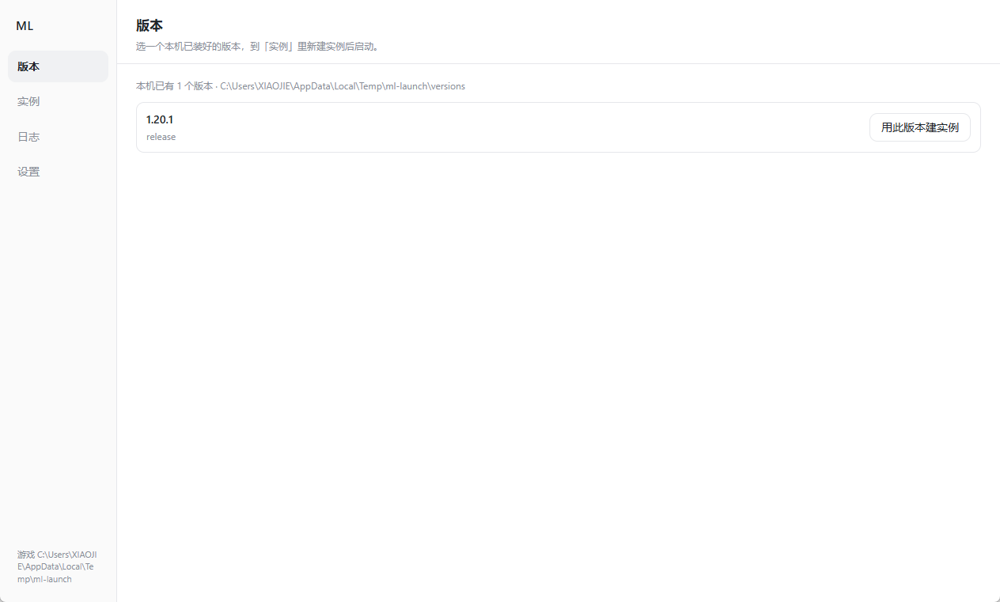

# Enderman Launcher

一个 Minecraft 启动器，内核只做启动，功能都写成插件。



---

## 特性

**实例**

- 一个实例 = 一套独立的存档、模组和设置，互不干扰
- 不同实例可以同时运行，每个有自己的日志窗口；同一实例只能开一个
- 新建、编辑（内存 / 窗口 / 玩家名）、删除（进回收站，可手动找回）

**启动**

- 从本机已有的版本启动，内存和窗口尺寸按实例配置
- 启动前检查文件完整性，缺的可以补
- 游戏输出单独一个日志窗口，退出后显示耗时与退出码

**安装**

- 原版版本安装由官方插件提供：拉取 Mojang 官方清单，一键装库、客户端、资源与 natives
- 所有下载走同一个队列：看得见进度、能暂停、能限速、断点续传、SHA1 校验

**账号**

- 正版（Microsoft 设备码登录）与离线账号混排，随时切换

**其他**

- 浅色 / 深色主题
- 崩溃后自动记录现场，重启时可选择保留或禁用出问题的插件
- 单文件便携版，数据放程序旁边

---

## 插件

插件是这个项目的主要扩展方式 —— **官方功能也走同一套 API，没有后门。**

| 能力 | 说明 |
|---|---|
| 加启动参数 | JVM 参数、游戏参数 |
| 拦截启动 | 返回拒绝原因，界面直接显示 |
| 加界面 | 一整页、启动层、设置块、工具栏按钮 |
| 用宿主能力 | 启动实例、装版本、下载队列、账号信息 |
| 子进程 | 自己起进程，交给宿主托管 —— 启动器退出时连进程树一起结束 |

三种形态：声明式（只有清单，加参数）、C# 程序集（完整能力）、整页 UI（HTML + JS）。

失败隔离：一个插件加载失败只影响它自己；运行中可随时启停，不用重启启动器。

**写插件从这里开始** → [插件开发指南](docs/05-插件开发指南.md)

---

## 快速开始

需要 [.NET 10 SDK](https://dotnet.microsoft.com/download)。

```bash
git clone https://github.com/TinyAII/enderman-launcher.git
cd enderman-launcher
dotnet run --project src/ML.Host -c Debug
```

首次启动会让你选 `.minecraft` 目录（或自己指定）。

打包：

```powershell
./build/publish.ps1
```

---

## 结构

```
src/
  ML.Host/                 宿主：WinForms + WebView2，界面之下的全部编排
  ML.Core/                 内核：从磁盘启动一个实例，零 UI 依赖、零网络
  ML.Features/             功能层：下载引擎、装机、Mojang 清单
  ML.Plugin.Abstractions/  插件契约（唯一对外冻结的接口面）
  ML.Plugin.Runtime/       插件加载、权限、生命周期
  ML.Web/                  界面（HTML / CSS / JS）
plugins/
  ML.Plugin.Vanilla/       官方插件：原版安装器
tests/                     内核测试
docs/                      设计文档与决策记录
```

**依赖方向是硬约束**：`plugins/*` 只能引用 `ML.Plugin.Abstractions`，不能引用内核或功能层。这样内核不会随功能膨胀。

---

## 文档

| 文档 | 内容 |
|---|---|
| [插件开发指南](docs/05-插件开发指南.md) | 你的第一支插件：清单、代码、界面、权限 |
| [插件能力盘点](docs/03-插件能力盘点与缺口.md) | 能做什么、不能做什么、还缺什么 |
| [主题变量](docs/04-主题变量.md) | 换肤可以覆盖哪些变量 |
| [总体方案](docs/00-总体方案.md) | 产品定位与分层 |
| [插件系统设计](docs/01-插件系统设计.md) | 扩展点、权限模型、隔离与生命周期 |
| [核心启动管线](docs/02-核心启动管线.md) | 目录布局、版本继承、下载引擎、认证 |
| [架构决策](docs/adr/) | 技术栈选型、契约设计、许可证 |

---

## 许可

**GPL-3.0-or-later**，附带[插件例外](LICENSE-EXCEPTION)：

- 启动器本体是 GPL —— 改了再分发必须开源
- **插件可以任意许可**（包括闭源、商业），不因被本程序加载而受 GPL 约束
- 契约程序集 [`ML.Plugin.Abstractions`](src/ML.Plugin.Abstractions) 单独按 [Apache-2.0](LICENSE-APACHE-2.0.txt) 授权

---

不是 Minecraft 官方产品，与 Mojang / Microsoft 无关。
