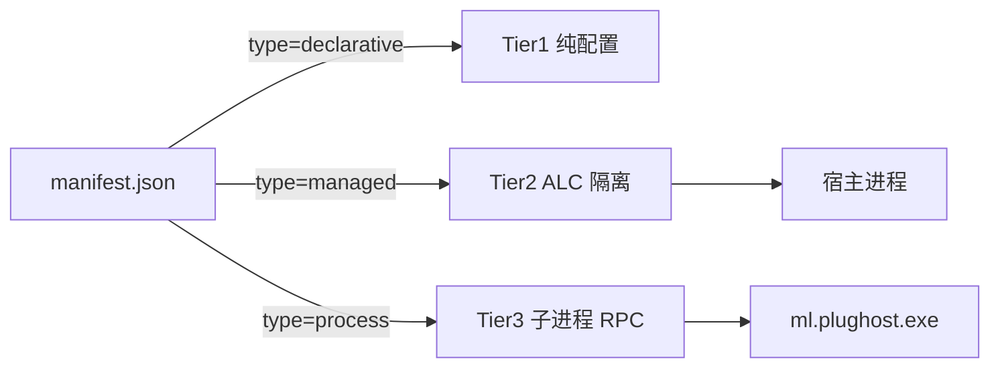

# 插件系统设计

> 本文档定义 `ML.Plugin.Abstractions`（冻结契约）与 `ML.Plugin.Host`（宿主实现）。所有接口签名是**草案**，M0 阶段会被三个原型插件打回来重写——这是预期行为。

> **2026-10-24 修订**：契约已落定到 **1.2** 并有官方插件在用（`ml.vanilla`），
> 所以「所有签名都是草案」只适用于还没实现的扩展点族（A~F 的其余部分）。
> 已实现的接口按契约对待：**只加不改**。

> **实现状态（2026-10-24，R2）**
>
> | 项 | 状态 |
> |---|---|
> | 清单解析与校验（schemaVersion / apiVersion / entry 越界） | ✅ `ML.Plugin.Runtime/PluginManifest.cs` |
> | 依赖拓扑排序、冲突、缺依赖、成环 | ✅ `PluginResolver.cs`（**版本区间未校验**，只校验存在性） |
> | Tier2 ALC 隔离加载（契约程序集回落默认上下文） | ✅ `PluginLoadContext.cs` |
> | 生命周期（初始化 10 秒超时、失败隔离、卸载） | ✅ `PluginManager.cs` |
> | 启用/禁用持久化 | ✅ `plugins/state.json` |
> | 扩展点 | ✅ `ILaunchHook`（加参数）/ `ILaunchGuard`（可否决启动）/ `IEventHook` / `IPluginCommand` |
> | Tier1 声明式 | ✅ 靠 `launch.jvmArgs` / `gameArgs`，不需要程序集 |
> | Tier3 子进程 | ⚠️ 只做了一半：`Host.AdoptProcess(pid)` 绑 Job Object，进程树随启动器死；起/收/发/停由插件用 BCL 自己做 |
> | 权限执行（`launch:jvm-args` / `launch:game-args` / `ui:page`） | ✅ 钩子在副本上跑；界面片段没权限不挂 |
> | 首次确认（needs-consent） | ✅ 声明了执行级权限但未同意的插件不加载，界面点「允许…」 |
> | 审计日志 | ✅ `<数据目录>/logs/plugin-audit.log`（制表符分隔，无 BOM） |
> | 其余权限（`ui:page` / `fs:instance` / `account:token` / `network:https`） | ⚠️ 只登记为预留，不生效 |
> | 安装（本地目录 / .mlp / GitHub zipball） | ✅ `PluginInstaller.cs`（已存在不覆盖） |
> | 页面注入（`ui:page`） | ✅ 5 个插槽：`startup` / `page` / `settings` / `instances.toolbar` / `account.before-list` |
> | 插件数据目录 | ✅ `数据目录/plugin-data/<id>/`，随 `IPluginContext.DataDirectory` 给出 |
> | 插件设置（`slot=settings` + KV 存储） | ✅ `plugin-data/<id>/settings.json`，界面与代码读写同一份 |
> | 宿主数据面 `IHostServices` | ✅ 游戏目录 / 实例（含 `Running`）/ 版本 / 账号 / `LaunchAsync` / `Installer` / `Downloads` / `AdoptProcess` / `ServerRoot` |
> | 插件命令 `IPluginCommand` | ✅ 页面 `MLPlugin.call(name, payload)` → 插件代码 |
> | 宿主事件 `IEventHook` | ✅ 4 个：`instance.created` / `launch.preparing` / `launch.started` / `launch.exited` |
> | 插件静态资源 `/plugin/<id>/...` | ✅ 只读插件目录内文件，穿越 404 |
> | 扩展点族 A~F 的其余部分 | ❌ 未做 |

---

## 0. 路线定位（2026-10-23 定稿）

**内核只做四件事：启动、账号、实例、插件宿主（含 UI 容器）。**
下载、整合包、Mod 管理、插件市场——**全部由插件实现，内核一行不碰**。

这条定位是参照 DeepSeek Harness（DSH）的插件模型定的：它的插件是 npm 包，跑在宿主进程里，
直接用 Node 的 fs / http 干活，官方页面明写"插件是第三方代码，装前请看源码"，没有沙箱也没有能力白名单。

据此定下三条：

1. **插件拥有完整能力**。Tier2 插件是 C# 程序，能直接用 `HttpClient` / `File` / 任何 BCL——
   内核不提供"网络 API""下载 API"，也不打算提供。内核提供的是**稳定接口**（启动钩子、界面插槽、数据目录），
   其余让插件自己干。
2. **权限是告知，不是沙箱**。`permissions` 的作用是"装的时候让用户看见"，不是"运行时拦住"。
   同进程插件本来就没有安全边界，把权限包装成安全承诺是骗人。
3. **不采用 Tier3（子进程）**。它买的是"崩了不连累宿主"和"能换语言写"，代价是插件碰不到宿主对象；
   而本项目的插件恰恰要改宿主行为。触发条件（三条全不满足就不做）：有非 C# 插件提交、要做审核型市场、
   出现插件导致宿主崩溃的真实事故。

### 后续排期

| 轮次 | 内容 | 状态 |
|---|---|---|
| R5 | 插件整页（侧栏入口 + 独立页面）、插件数据目录 | ✅ 2026-10-23 |
| R6 | 插件行可点开 → 详情弹窗；插件自带设置片段 + 键值存储 | ✅ 2026-10-23 |
| R7 | 宿主数据面 + 插件命令通道 + 三个宿主事件 | ✅ 2026-10-23 |

| 待定 | 启动器内"第三方代码"免责页 + 安装来源/哈希 | 未做 |
| 不做 | Tier3、能力 API 白名单、依赖版本区间 | 明确不做 |

---

## 1. 设计目标与核心矛盾

插件系统要同时满足三个互相拉扯的目标：

| 目标 | 具体要求 |
|---|---|
| **表达力** | 插件能做出和内核自带功能一样好的东西（能加页面、能加安装流程、能加下载源、能加登录方式） |
| **稳定性** | 插件崩了不能拖垮宿主；插件升级不能要求宿主升级；宿主升级不能弄坏插件 |
| **安全性** | 插件是任意代码，用户必须能看见它要什么、能拒绝、能撤销 |

三者不可能都满分，取舍原则：

> **稳定性和安全性用机制保证；表达力用"多档位"换取——愿意付出更多约束的插件获得更好的兼容性，愿意承担更多风险的插件获得更强的能力。**

这就是三档插件形态的由来。此外还有两个反直觉的结论，会贯穿全文：

- **不要给插件 `IApplication` / 窗口句柄 / 控件树**。给了就必须保证永远兼容，等于把整个 UI 框架冻结进契约。改为"声明式 UI 描述树 + 宿主渲染"。
- **不要用抽象基类做扩展点**。用"能力注册"（register an implementation of a narrow interface）。基类一改构造函数，所有插件全挂；接口加个默认实现（DIM）就能平滑演进。

---

## 2. 三档插件形态

| 档位 | 声明 | 运行位置 | 能力 | 适用 |
|---|---|---|---|---|
| **Tier 1** 声明式 | `"type": "declarative"` | 不运行代码，只有 JSON | 加下载源 URL 规则、加镜像、加主题色板、加启动参数片段、加崩溃归因规则 | 纯配置类插件，零风险，可热加载 |
| **Tier 2** 托管进程内 | `"type": "managed"` | 宿主进程内，独立 `AssemblyLoadContext` | 全量 API：自定义安装任务、认证提供者、UI 页面、事件钩子 | 绝大多数功能插件 |
| **Tier 3** 独立进程 | `"type": "process"` | `ml.plughost.exe` 子进程，JSON-RPC | 同上，但通过 RPC 代理；无 UI 直接绘制能力（走声明式 UI） | 不可信来源、带原生依赖、可能崩溃/内存泄漏的插件 |

Tier 2 是主力。Tier 1 的存在让"只改一个下载源"这种需求不需要写代码（也不该需要）。Tier 3 是把安全与稳定风险外置的逃生口。



---

## 3. 插件包格式

插件是一个**目录**（`.mlp` 是 zip 后缀别名，安装时解压到插件目录）：

```
plugins/
└── com.example.modrinth/
    ├── manifest.json            # 必需
    ├── Example.Modrinth.dll     # Tier2/3 必需
    ├── Example.Modrinth.deps.json
    ├── lib/                     # 插件私有依赖（ALC 从这里解析，不污染宿主）
    ├── assets/                  # 图标、本地化
    └── README.md
```

**私有依赖必须放 `lib/`**，通过自定义 `AssemblyDependencyResolver` 从插件目录解析。任何情况下**不允许**插件把自己的 DLL 丢进宿主目录——这是 .NET 插件系统最常见的踩坑点（版本冲突导致宿主启动失败）。

### 3.1 manifest.json

```json
{
  "schemaVersion": 1,
  "id": "com.example.modrinth",
  "name": "Modrinth 整合包支持",
  "version": "1.2.0",
  "authors": ["Example"],
  "description": "从 Modrinth 安装整合包",
  "homepage": "https://example.com",
  "apiVersion": "1.0",
  "type": "managed",
  "entry": "Example.Modrinth.dll",
  "entryType": "Example.Modrinth.Plugin",
  "permissions": [
    "network:https",
    "fs:instance",
    "ui:page"
  ],
  "optionalPermissions": ["account:offline"],
  "dependencies": {
    "com.example.core": ">=1.0.0 <2.0.0"
  },
  "loadAfter": ["com.example.accounts"],
  "loadBefore": [],
  "conflicts": ["com.other.modrinth"],
  "minHostVersion": "1.0.0",
  "platforms": ["windows", "linux", "macos"]
}
```

字段约束：
- `id`：反向域名，全局唯一，**永不改变**（改了等于新插件，用户配置不迁移）。
- `apiVersion`：插件编译针对的契约版本。宿主按"主版本必须相等，次版本≥"匹配。
- `minHostVersion`：低于此版本拒绝加载并给出可读提示（而不是抛异常）。
- `permissions`：见第 6 节。声明即最小集合，运行时申请额外权限需用户二次确认。
- `entry` / `entryType`：Tier1 不需要。程序集路径必须相对插件根，禁止 `..` 逃逸。

---

## 4. 扩展点目录

扩展点分六族。**M0 只做族 A、B、E，其余按需增补**——不要一开始就把所有扩展点铺满。

### 族 A：安装与版本（安装器扩展）

```csharp
namespace ML.Plugin.Abstractions.Install;

/// 一个可安装的"东西"（原版、Forge、整合包、资源包……）
public interface IInstallProvider
{
    string Id { get; }                        // "forge" / "fabric" / "modrinth.modpack"
    string DisplayName { get; }
    /// 判断某个输入（版本 id、文件路径、URL）能否由本提供者安装
    ValueTask<bool> CanHandleAsync(InstallRequest request, CancellationToken ct);
    /// 产出安装任务，宿主负责调度与进度显示
    ValueTask<IReadOnlyList<IInstallTask>> PlanAsync(
        InstallRequest request, IInstallPlanContext ctx, CancellationToken ct);
}

public interface IInstallTask
{
    string Title { get; }                     // 显示在进度面板
    double Weight { get; }                    // 进度权重，宿主归一化
    ValueTask ExecuteAsync(IInstallTaskContext ctx, CancellationToken ct);
}
```

`IInstallTaskContext` 暴露的是内核能力的安全子集：`DownloadAsync(uri, target, sha1)`、`ExtractAsync`、`WriteVersionJson`、`ReportProgress(0..1, message)`、`Logger`。插件拿不到 HttpClient 原始对象，所有网络必须走内核下载引擎（这样镜像、限速、重试策略统一生效）。

### 族 B：下载源与镜像

```csharp
public interface IDownloadSource
{
    string Id { get; }
    int Priority { get; }                     // 数值越小越优先
    /// 返回改写后的 URL；返回 null 表示不处理，交给下一个源
    /// kind: Library / Asset / AssetIndex / VersionManifest / JavaRuntime / Installer
    Uri? Resolve(DownloadKind kind, Uri original, string? sha1);
}
```

这是最低门槛的扩展点，也是 Tier1 声明式插件的主要落点：

```json
{
  "type": "declarative",
  "downloadSources": [
    { "kind": "asset", "matchHost": "resources.download.minecraft.net",
      "rewriteTo": "https://bmclapi2.bangbang93.com/assets" },
    { "kind": "library", "matchHost": "libraries.minecraft.net",
      "rewriteTo": "https://bmclapi2.bangbang93.com/maven" }
  ]
}
```

### 族 C：账户与认证

```csharp
public interface IAuthProvider
{
    string Id { get; }                        // "microsoft" / "offline" / "authlib.xxx"
    string DisplayName { get; }
    ValueTask<AuthResult> AuthenticateAsync(IAuthContext ctx, CancellationToken ct);
    ValueTask<AuthResult> RefreshAsync(StoredAccount account, IAuthContext ctx, CancellationToken ct);
    ValueTask SignOutAsync(StoredAccount account, CancellationToken ct);
}

public sealed record AuthResult(
    string PlayerName,
    string Uuid,
    string AccessToken,       // 只交还宿主，不落盘到插件可读位置
    string UserType,          // "msa" / "legacy" / "mojang"
    DateTimeOffset? ExpiresAt,
    IReadOnlyDictionary<string, string>? ExtraProperties);  // 如 authlib-injector 的 apiRoot
```

安全要点：`AccessToken` 由宿主加密存储（Windows DPAPI / macOS Keychain / Linux Secret Service），**插件在后续会话中无法读回明文**，只能通过 `IAuthContext.GetTokenAsync(accountId)` 获取短期令牌用于启动。这是防"插件偷号"的关键设计。

### 族 D：UI 扩展

见第 5 节。接口：

```csharp
public interface IUIExtension
{
    /// 主界面左栏/顶栏的一个入口
    ValueTask<NavigationEntry?> GetNavigationEntryAsync(CancellationToken ct);
    /// 设置页中的一个分组
    ValueTask<SettingsGroup?> GetSettingsGroupAsync(CancellationToken ct);
    /// 版本列表项上的一个操作按钮（右键菜单）
    ValueTask<IReadOnlyList<ContextAction>?> GetVersionContextActionsAsync(CancellationToken ct);
}
```

### 族 E：事件钩子

```csharp
public interface ILaunchHook
{
    /// 启动前：可修改参数、可中止启动（返回 Deny 并给原因）
    ValueTask<LaunchDecision> OnBeforeLaunchAsync(LaunchContext ctx, CancellationToken ct);
    ValueTask OnLaunchedAsync(LaunchedProcess process, CancellationToken ct);
    ValueTask OnExitedAsync(ExitInfo info, CancellationToken ct);
}

public interface IDownloadHook
{
    ValueTask<DownloadDecision> OnBeforeDownloadAsync(DownloadItem item, CancellationToken ct);
    ValueTask OnDownloadFailedAsync(DownloadItem item, Exception ex, CancellationToken ct);
}
```

`LaunchContext` 允许 `ctx.JvmArgs.Add("-XX:+UseG1GC")`、`ctx.GameArgs.Add(...)`、`ctx.MemoryMb = 8192`。**不允许**改 classpath 与主类（那是内核不变量，改了就不可诊断）。

事件总线（只读通知，无返回值）：

```csharp
public interface IEventBus
{
    IDisposable Subscribe<TEvent>(Func<TEvent, CancellationToken, ValueTask> handler) where TEvent : IPluginEvent;
    ValueTask PublishAsync<TEvent>(TEvent evt, CancellationToken ct) where TEvent : IPluginEvent;
}
// 内置事件：InstanceCreated / InstanceDeleted / VersionInstalled / GameStarting / GameExited / CrashDetected / DownloadCompleted
```

### 族 F：数据与服务（提供给插件的宿主能力）

```csharp
public interface IPluginContext
{
    string PluginId { get; }
    string DataDirectory { get; }             // 插件私有可写目录，卸载时可清理
    ILogger Log { get; }
    IServiceProvider Services { get; }        // 解析内核提供的服务接口
    IPermissionBroker Permissions { get; }    // 运行时申请额外权限
    IEventBus Events { get; }
    IPluginSettings Settings { get; }         // 插件自己的配置存储（JSON，宿主托管）
    ILocalization Loc { get; }                // 本地化资源
}
```

内核通过 `Services` 暴露的具体接口（**均只读或受限写**）：`IVersionCatalog`、`IInstanceService`、`IJavaService`、`IDownloadService`、`IPathService`、`INotificationService`、`IProcessService`（只读查询）。

---

## 5. UI 扩展：双轨制

这是全系统最容易设计错的地方，也是技术栈选型的决定性依据（见 `00-总体方案.md` 决策 B 理由 1）。

**结论先说：插件的界面必须允许是"代码"，不是"数据"。** 一个插件想在主界面加一页"整合包市场"，里面要有搜索框、平台标签筛选、虚拟滚动的几百个条目、悬停预览、可点击的依赖图——这不是一棵 POCO 视图树能表达的东西。而如果让插件把代码注入宿主进程（进程内 XAML 那条路），一个画错的循环就能把整个启动器带走，而且宿主此后不能换 UI 框架。

WebView2 让这件事有了干净的答案：**界面是独立渲染进程里的网页**。插件 UI 崩了，宿主还活着；宿主想换 UI 框架，插件页面一行不用改。

### 轨 A：HTML 资源包（**推荐，主路径**）

插件包里带一个 `ui/` 目录，装的是普通前端产物（`index.html` + JS + CSS，可以是 Vite 打出的 bundle）。宿主在**沙箱 iframe** 里加载它，`sandbox="allow-scripts"` 且不共享宿主 origin，双向只走 `postMessage`。

```jsonc
// manifest.json 片段
"ui": {
  "kind": "html",              // 主路径
  "entry": "ui/index.html",
  "surfaces": ["nav"],         // 出现在左侧导航
  "title": "整合包市场",
  "icon": "icons/pack.svg",
  "minSize": [640, 480]
}
```

插件页面里只需要一个小到不可能变的东西：

```ts
// 插件作者写的全部"桥"代码
const ml = {
  request: (cmd: string, data?: unknown) => {
    const seq = Math.random().toString(36).slice(2);
    return new Promise((resolve, reject) => {
      const timer = setTimeout(() => reject(new Error(`超时：${cmd}`)), 120_000);
      const onMessage = (e: MessageEvent) => {
        const m = e.data;
        if (m?.seq !== seq) return;
        window.removeEventListener('message', onMessage);
        clearTimeout(timer);
        m.error ? reject(new Error(m.error)) : resolve(m.payload);
      };
      window.addEventListener('message', onMessage);
      parent.postMessage({ seq, cmd, data }, '*');
    });
  },
};

// 用起来
const list = await ml.request('modpack.search', { query: 'optimized' });
```

三条硬约束（写进插件文档，不写就是坑）：

1. **`cmd` 的命名空间必须是插件自己的**（`modpack.*`），宿主按 manifest 里声明的权限与命名空间路由；插件调 `install.start` 这类宿主命令要走 `host.*` 前缀并接受权限检查。
2. **主题用 CSS 变量继承，不给插件组件库。** 宿主在 iframe 上注入 `--ml-bg` / `--ml-fg` / `--ml-accent` 等变量（跟随用户主题实时更新），插件自己写样式。理由：给 JS 组件库等于把前端实现冻进插件契约，一年后改不动。
3. **不做 DOM 共享。** 插件不接触宿主页面，宿主不接触插件 DOM。跨界的只有 JSON 消息。这一条让"插件把宿主 UI 改崩"在物理上不可能。

### 轨 B：声明式视图树（**受限场景**，仍然保留）

有些插件只是想加一个"设置"页：三个输入框、一个下拉、一个保存按钮。为了这个去装 node + vite + 打包，是劝退。

所以保留声明式轨道：插件产出 POCO 树，宿主用自己的渲染器把它变成 HTML（渲染器 200 行以内，且**不属于插件契约**——它是宿主的实现细节，可以随时重写）。

```csharp
public abstract record ViewNode;
public sealed record VStack(IReadOnlyList<ViewNode> Children, double Spacing = 8) : ViewNode;
public sealed record HStack(IReadOnlyList<ViewNode> Children, double Spacing = 8) : ViewNode;
public sealed record TextBlock(string Text, TextStyle Style = TextStyle.Body) : ViewNode;
public sealed record Button(string Text, string ActionId, bool IsPrimary = false) : ViewNode;
public sealed record TextBox(string Label, string BindingPath, string? Placeholder = null) : ViewNode;
public sealed record CheckBox(string Label, string BindingPath) : ViewNode;
public sealed record ComboBox(string Label, string BindingPath, IReadOnlyList<Option> Options) : ViewNode;
public sealed record ListBox(string BindingPath, IReadOnlyList<Column> Columns) : ViewNode;
public sealed record ProgressBar(string BindingPath) : ViewNode;
public sealed record Card(string Title, IReadOnlyList<ViewNode> Children) : ViewNode;
public sealed record Markdown(string Content) : ViewNode;
public sealed record Image(string SourceUri, double Height = 24) : ViewNode;
```

交互：插件返回一棵树 + 一个 view-model（POCO 字典），宿主渲染后把用户操作回调成 `HandleActionAsync(actionId, state)`。**插件代码只在自己的 handler 里跑（有超时与异常包裹），从不介入渲染循环。**

```csharp
// 轨 B 的一个完整页面插件（没有前端工程，没有 node）
public sealed class ModpackSettingsPage : IUIExtension
{
    public ValueTask<NavigationEntry?> GetNavigationEntryAsync(CancellationToken ct) =>
        ValueTask.FromResult<NavigationEntry?>(new("整合包", "icons/pack.svg", _ => ValueTask.FromResult<ViewNode>(
            new Card("安装选项", [
                new TextBox("默认安装目录", "dir", "%APPDATA%\\.minecraft"),
                new ComboBox("并发数", "threads", [new("4", "4"), new("8", "8"), new("16", "16")]),
                new Button("保存", "save", IsPrimary: true)
            ]))));

    public ValueTask HandleActionAsync(string actionId, IReadOnlyDictionary<string, object?> state, CancellationToken ct) { /* ... */ }
}
```

### 为什么不做第三条路：让插件直接改宿主页面

技术上做得到（同一个 DOM），文档里明确禁止，且宿主不提供任何接口。理由不是洁癖：**一旦允许，宿主的 CSS/HTML 结构就被冻进插件契约**，等于给自己上了一个永久的兼容性枷锁，和当初拒绝"进程内 XAML"是同一个理由。

---

## 6. 权限模型

## 6. 权限模型

权限串格式：`域:范围[:限定]`。

| 权限 | 含义 | 风险 |
|---|---|---|
| `network:https` | 出站 HTTPS（必须走内核下载引擎或被审计的 HttpClient） | 中：数据外泄、C2 |
| `network:any` | 任意网络（含非 HTTPS、任意端口、raw socket） | 高 |
| `fs:instance` | 读写当前实例目录（`mods/`、`config/`、`saves/`…） | 中：可改存档 |
| `fs:plugin-data` | 只读写自己的 `DataDirectory`（**默认授予**） | 低 |
| `fs:any` | 任意路径读写 | 高 |
| `process:java` | 启动/管理游戏进程（只能通过内核 API） | 中 |
| `process:any` | 自己起任意进程 | 高 |
| `ui:page` | 注册页面/导航项 | 低 |
| `ui:native` | 使用轨 B 原生视图 | 中（可注入任意控件） |
| `account:offline` | 创建离线账户 | 低 |
| `account:read` | 读取账户列表与非敏感信息（name/uuid） | 低 |
| `account:token` | 请求某账户的短期启动令牌 | **高，必须每次确认** |
| `plugin:interop` | 调用其他插件的公开 API | 中 |

规则：
1. **最小权限默认拒绝**。未声明就用 → 抛 `PermissionDeniedException`，错误信息直接告诉用户"插件 X 试图使用未声明的能力 fs:any"。
2. **首次安装弹确认清单**，按风险分组，高风险项单独高亮，提供"拒绝并禁用该插件"按钮。
3. **`account:token` 每次调用都要确认**（不是安装时一次），且 UI 显示"插件 X 想用你的账户 <name> 启动游戏"。
4. **权限不可静默扩大**。插件升级新增权限 → 视为需要重新确认，插件保持禁用直到用户同意（这是 Chrome 扩展的成熟做法）。
5. **审计日志**：所有敏感 API 调用写入 `logs/plugin-audit.log`（时间、插件 id、API、结果），用户可查看。

---

## 7. 隔离、生命周期与故障处理

### 7.1 加载顺序

```
1. 扫描 plugins/ 与用户目录，读 manifest，校验 schema 与 minHostVersion
2. 剔除不兼容（apiVersion 主版本不匹配）与平台不匹配的，记录原因
3. 处理 conflicts（冲突双方都禁用，提示用户选择）
4. 依赖拓扑排序（dependencies + loadAfter/loadBefore），检测环 → 环内全部禁用并报错
5. 按序创建 AssemblyLoadContext（Tier2）或 spawn 子进程（Tier3）
6. 逐个 InitializeAsync（串行，每插件 10s 超时；超时即禁用）
7. 注册扩展点（任何注册冲突 = 后者失败，不覆盖前者）
8. 触发 HostReady 事件
```

**串行初始化**是有意选择：并行初始化会让"插件 A 依赖插件 B 已注册的扩展点"变得不可预测。

### 7.2 AssemblyLoadContext 隔离

```csharp
internal sealed class PluginLoadContext : AssemblyLoadContext
{
    private readonly AssemblyDependencyResolver _resolver;
    private readonly string _pluginDir;

    public PluginLoadContext(string entryPath) : base(isCollectible: true)
    {
        _pluginDir = Path.GetDirectoryName(entryPath)!;
        _resolver = new AssemblyDependencyResolver(entryPath);
    }

    protected override Assembly? Load(AssemblyName name)
    {
        // ★ 关键：契约程序集与宿主共享，绝不重复加载
        if (HostSharedAssemblies.Contains(name.Name!))
            return null;                    // null = 回退到 Default ALC

        var path = _resolver.ResolveAssemblyToPath(name);
        return path is not null ? LoadFromAssemblyPath(path) : null;
    }

    protected override IntPtr LoadUnmanagedDll(string name)
    {
        var path = _resolver.ResolveUnmanagedDllToPath(name);
        return path is not null ? LoadUnmanagedDllFromPath(path) : IntPtr.Zero;
    }
}
```

`HostSharedAssemblies` 是一个白名单，只有 `ML.Plugin.Abstractions` 和极少数基础类型（`System.Runtime` 等由 Default ALC 提供）。**其他一切插件依赖都进插件自己的 ALC**，这样两个插件依赖不同版本的 Newtonsoft.Json 也不会打架。

可卸载性（`isCollectible: true`）让"禁用插件后无需重启"成为可能，但要注意：**任何遗留引用（事件订阅、静态缓存、未断开的 Timer）都会阻止卸载**。对策：卸载前调用 `ShutdownAsync` 并 `Dispose` 掉 `IPluginContext` 发出的所有 `IDisposable`（宿主内部维护每个插件的 disposable 清单），再 `Unload()` + 循环 `GC.Collect()` 最多 10 次；若仍无法卸载，提示"需重启生效"。这是诚实的做法，别假装能 100% 卸载。

### 7.3 故障隔离与熔断

| 场景 | 处理 |
|---|---|
| 插件 API 调用抛异常 | 宿主捕获，记录完整栈 + 插件 id，向用户显示"插件 X 出错"（不是"启动器崩溃"），继续执行 |
| 连续 3 次未处理异常 | 本次会话内自动禁用该插件，通知用户；`DataDirectory` 保留 |
| `InitializeAsync` 超时 10s | 禁用 |
| 事件 handler 超时 5s | 记警告；3 次后该 handler 摘除 |
| 插件死循环 / 栈溢出 | **in-proc 无法恢复**（这是 Tier2 的固有代价）。文档明确：不可信插件请用 Tier3 |
| 插件导致进程崩溃 | 启动时写"上次运行中插件 X 处于活动状态"标记；下次启动若检测到非正常退出且是启动器本身崩的，自动进入**安全模式**（禁用全部 Tier2/3 插件），并提示用户逐个启用 |
| Tier3 插件进程崩溃 | 宿主检测到子进程退出，标记插件为 crashed，可一键重启该插件（其他插件无感） |

熔断状态持久化在 `state/plugin-health.json`，避免"每次启动都先崩一次"。

### 7.4 生命周期接口

```csharp
public interface IMLPlugin
{
    /// 只做注册，不做重活。10s 超时。
    ValueTask InitializeAsync(IPluginContext ctx, CancellationToken ct);
    /// 释放资源。宿主随后卸载 ALC。
    ValueTask ShutdownAsync(CancellationToken ct);
}
```

---

## 8. 分发与更新

### M4（第一阶段做法，零服务端成本）

- 插件来源 = 用户手动选的 `.mlp` 文件，或官方仓库里的 `plugins/` 目录。
- 安装时：校验 zip 结构 → 读 manifest → 权限确认 → 解压到 `plugins/<id>/`（先解压到临时目录再原子 rename，避免半成品）→ 写入 `state/installed.json`（记录 id、版本、来源、文件哈希）。
- 更新：提示"有新版本"，用户重新选文件覆盖；`DataDirectory` 不删。
- 卸载：删目录 + 删/留 DataDirectory（问用户）。

### M5（索引服务）

```
GET /v1/index.json
{
  "plugins": [
    { "id": "com.example.modrinth", "versions": [
        { "version": "1.2.0", "apiVersion": "1.0", "download": "https://.../1.2.0.mlp",
          "sha256": "...", "signature": "...", "permissions": ["network:https","fs:instance"] }
    ]}
  ]
}
```

- **签名**：作者用 Ed25519 私钥签 manifest+文件哈希；索引服务只收录能验签的版本。客户端显示"已验证作者"。
- **未签名插件仍可安装**，但标红"未验证来源"，并在启用时二次确认。不要做强制签名——会杀死早期生态。
- **不做**自动更新静默安装（权限可能变化），一律"提示 + 用户确认"。

---

## 9. API 版本策略

| 变化 | 版本位 | 示例 |
|---|---|---|
| 加接口方法（带默认实现）/ 加可选参数 / 加新扩展点 | minor | `1.2 → 1.3` |
| 改行为语义、改默认值 | minor（+ 变更日志，需谨慎） | — |
| 删/改接口签名、加必填方法、改扩展点契约 | **major** | `1.x → 2.0` |

实现手段：
- 新能力优先用**独立的新接口**（`IDownloadSource2`）而不是改老接口。
- 必须改老接口时用 **Default Interface Method** 给默认实现（.NET 支持），老插件无需重编译。
- 契约程序集内**不出现** `internal` 类型、不出现任何 UI 框架类型（`Avalonia` / WinForms / WebView2）、不出现 `ML.Core.*` 类型。CI 里加一条检查：`ML.Plugin.Abstractions` 的引用清单只能是 `System.*`。

最后这条 CI 检查非常重要——契约程序集一旦引用了内核类型，内核的每次重构都会变成插件的破坏性变更。

---

## 10. 官方插件 = 参考实现（机制性约束）

`plugins/` 下所有项目：
- `<ProjectReference Include="../../src/ML.Plugin.Abstractions" />`，**不得**引用 `ML.Core.*`、`ML.Shell`。
- 不开 `InternalsVisibleTo`。
- 走公开的插件加载路径（不是特批内置）。

CI 里加一条 gate：若 `plugins/**` 的引用图出现 `ML.Core.*`，构建失败。

这样做的收益不只是"验证 API"——它保证内核对插件的能力边界是真实边界。一旦有人（包括你自己）想走捷径，CI 会拦住。

---

## 11. M0 要回答的 10 个具体问题

M0 的产出不是代码，是这 10 个问题的答案。每个问题都要用原型代码验证，不能靠讨论。

1. 整合包导入（要下载、解压、写实例、显示进度、调外部 API）能不能**不碰 `ML.Core.*`** 写完？差什么？
2. 外置登录（要改 JVM 参数加 `-javaagent`、要自定义 token 生命周期）能不能写完？`LaunchContext` 够不够？
3. 一个"只加下载源"的需求，Tier1 JSON 够不够覆盖 90% 场景？
4. 声明式 UI 能不能做出"实例列表 + 每项右键菜单 + 分页"这种真实界面？
5. 插件写自己的设置页，`IPluginSettings` 的 API 够不够（分组、校验、迁移）？
6. 两个插件都要接管"启动前检查"时，顺序怎么定？`loadAfter` 够不够？
7. 插件 A 要调用插件 B 的能力（如"皮肤插件"要被"账户插件"调用），`plugin:interop` 的形态是什么？
8. 插件想在后台跑长任务（扫描全部实例的模组更新），宿主有没有任务队列？进度在 UI 哪里显示？
9. 本地化：插件的中文/英文资源怎么和宿主的语言切换联动？
10. 卸载插件时 `DataDirectory` 里的用户数据（比如整合包下载缓存）怎么处理才不惹用户？

第 1、2、4 题如果有一道过不去，说明 API 结构错了，此时推翻重做代价最小（M0 只有原型，没有用户）。
